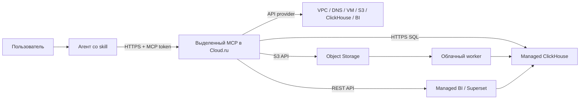

# Cloud.ru Sales Report — skill + MCP

**Дайте ссылку своему агенту, чтобы он помог получить отчёт по продажам в Cloud.ru.** Пользователь выбирает задачу, предоставляет доступ и согласует стоимость; агент готовит инфраструктуру, загружает данные и проверяет результат через API.

> **Статус: предварительная версия, не production-ready.** Код, переносимая установка и расчёты проверены автоматическими тестами. Полный проход с реальным Cloud.ru, API-авторизация Managed BI, пользовательский вход в BI и установка во всех заявленных клиентах **ещё не подтверждены**. Этот репозиторий не предоставляет уже работающий общий MCP endpoint. Не обещаем, что «любой агент получит отчёт одним действием».

## Что изменилось в 0.3.0 (после реального облачного прогона 28–29.10.2026)

- Пользователь делает в консоли только два действия: личный ключ доступа и Tenant ID Object Storage ([шаги со скриншотами](skills/cloudru-sales-report-mcp/references/console-steps.md)). Сервисный аккаунт, его роли и ключ создаёт сам шаблон (`service_account_id: null`).
- Шаблон исправлен по итогам прогона: CIDR/шлюз/routed для подсетей, DNS-подсеть для Data Platform/BI/ClickHouse, `replicas=1`, правило 80/tcp для Let's Encrypt, cloud-init без image_metadata, любые версии UUID.
- Скрипты bootstrap в `scripts/bootstrap/`: запуск Terraform с ключом из защищённого файла, установка VM (OpenTofu, Caddy, публичный DNS), сборка секретов, ротация MCP-токена, наблюдение за кластером ClickHouse с детекцией зависания. Порядок — в [bootstrap.md](skills/cloudru-sales-report-mcp/references/bootstrap.md).
- [Известные проблемы платформы](skills/cloudru-sales-report-mcp/references/troubleshooting.md) и шаблон обращения в поддержку. Главная: Managed ClickHouse может навсегда остаться в «Создается» без хостов, и такой кластер не удаляется через API.
- Одно консолидированное согласие пользователя перед apply (SKILL.md): смета, порт 80, платный BI как запасной вариант, одно пересоздание.
- Факт прогона: VM, MCP по HTTPS, подключение клиента Claude Code и кластер Data Platform подтверждены; ClickHouse и Managed BI не поднялись из-за сбоя платформы (обращение в поддержку подготовлено), поэтому data pipeline и BI verify по-прежнему **не подтверждены облачным e2e**.

## Дайте агенту этот промпт

```text
Установи навык Cloud.ru Sales Report из:
https://github.com/dmayudin/cloudru-sales-report-mcp

Сначала прочитай README.md, INSTALL.md и
skills/cloudru-sales-report-mcp/SKILL.md.
Получи весь пакет из зафиксированной версии, не только один SKILL.md.

Определи подходящий для тебя способ установки skill и подключения
удалённого MCP. Установи навык, проверь ссылки на его файлы и сразу
расскажи простыми словами, что можешь сделать и что нужно от меня.

Проведи меня как нетехнического пользователя до отчёта по продажам.
Уточни, есть ли аккаунт Cloud.ru, откуда данные и нужен ли разовый
отчёт или обновление. Все технические шаги выполняй сам.
Не используй браузерную автоматизацию и локальные серверы.
Ключи не запрашивай в чате: подготовь безопасный ввод.
До платных изменений покажи полную стоимость и получи согласие.
Честно называй неподдерживаемые возможности и результаты проверок.
```

[Все готовые промпты](prompts/README.md) · [Установка для агента](INSTALL.md) · [Сам навык](skills/cloudru-sales-report-mcp/SKILL.md)

**После установки агент должен продолжить работу**, а не только сказать «установлено». Ожидаемое первое сообщение: «Помогу получить отчёт по выручке и марже. Есть ли аккаунт Cloud.ru? Где данные? Нужен один отчёт или обновление? Ключи сюда не присылайте; стоимость покажу до создания ресурсов».

## Для кого и какой результат

Для владельца небольшого бизнеса, которому нужна понятная сводка продаж, но не хочется администрировать облако. Первый сценарий: полный CSV-снимок → Object Storage → Managed ClickHouse → Managed BI. Отчёт показывает выручку и contribution-маржу по каналам. Возвраты учитываются отдельными строками со знаком минус. Contribution = выручка − себестоимость − комиссии; это не чистая прибыль бизнеса.

Финальный результат — **проверенная ссылка на BI**, способ входа, период и свежесть данных, режим обновления и полная ориентировочная стоимость за месяц. Успешный Terraform apply, URL внутреннего сервиса или опубликованный dashboard без сверки данных не считаются сдачей.

## Путь пользователя (CJM)

| Этап | Что делает пользователь | Что делает агент |
|---|---|---|
| Установка | Даёт ссылку на пакет | Проверяет источник и возможности клиента, устанавливает skill, продолжает onboarding |
| Аккаунт | Сообщает, есть ли Cloud.ru | Выбирает ветку нового/существующего клиента |
| Регистрация | Сам подтверждает личность, условия и оплату | Даёт короткие пошаговые инструкции, не просит пароль или SMS-код |
| Доступ | Предоставляет ограниченный доступ через защищённый ввод | Подбирает права, проверяет IAM и проект через API |
| Задача | Выбирает данные и режим | Проверяет контракт, права, поддерживаемый источник и условия хранения |
| Стоимость | Согласует понятную полную оценку | Считает все компоненты, не выдаёт неизвестные расходы за ноль |
| Выполнение | Следит за короткими статусами | Создаёт ресурсы, размещает MCP в облаке, импортирует, публикует и сверяет BI |
| Передача | Открывает отчёт | Даёт ссылку, инструкцию входа, свежесть и стоимость |
| Обновление | Присылает файл или разрешает источник | Обновляет существующий отчёт, проверяет новое содержимое |

[Подробный onboarding](skills/cloudru-sales-report-mcp/references/onboarding.md) · [Стоимость и управление](skills/cloudru-sales-report-mcp/references/product.md)

Пользователь может сам открыть консоль для регистрации и первичной выдачи доступа. Запрет браузера относится к автоматизации агента: он не извлекает сессии и не выполняет инфраструктурные действия через UI.

## Что реализовано и что не проверено

| Возможность | Состояние |
|---|---|
| Переносимый SKILL.md, ссылки на ресурсы, установщик без запуска приложения | Реализовано, проверена чистая установка во временный каталог |
| Streamable HTTP MCP с отдельным bearer token | Реализовано; настоящий удалённый handshake ещё требует проверки |
| Инфраструктура через официальный Terraform API provider Cloud.ru 2.1.5 | Шаблон проверен провайдером; live apply не выполнен |
| CSV validation, S3 upload, ClickHouse import/report, повтор без логических дублей | Реализовано, unit/in-process проверки; Cloud.ru e2e не выполнен |
| Superset REST connection/dataset/chart/dashboard и сверка chart-data | Реализован адаптер; совместимость авторизации и driver в Managed BI не подтверждена |
| Разовый файл / новые файлы по запросу | Реализовано на уровне tools |
| Автоматическое получение полного файла из приватного S3 | Реализованы adapter, worker и timer; scheduled run в облаке не проверен |
| Google Drive, Dropbox, 1С, Ozon, WB | Готовых коннекторов нет |
| Полная оценка стоимости | Есть калькулятор; проверенные тарифы получает и заполняет агент/оператор |
| Автоматическое ограничение расходов / удаление среды | Не реализовано |
| Общий hosted MCP, web-форма секретов, multi-tenant изоляция | Не предоставляются |
| Codex / Claude Code / Hermes | Общий файловый пакет; клиентский e2e отдельно ещё не выполнен |

Подробнее: [приёмка CJM](docs/cjm-acceptance.md), [доказательства и ограничения](docs/api-only-verification.md), [чек-лист облачного испытания](docs/ACCEPTANCE.md).

## Первый раз в облаке

[Подробный маршрут для новичка](skills/cloudru-sales-report-mcp/references/first-time-cloud.md): регистрация, выбор проекта, отдельный доступ программы, роли, ключ и типичные затруднения. Агент выдаёт одну карточку за раз и продолжает с подтверждённого шага. [Точный профиль ролей](skills/cloudru-sales-report-mcp/references/access-roles.md) разделяет права человека, агента и аккаунта кластера; неподтверждённые предпосылки обозначены явно.

Если уже запутались, используйте [промпт сопровождения](prompts/09-help-me-connect.md). Маршрут сверен с документацией; тест понятности с реальным новичком ещё нужен.

## Совместимость с агентами

Навык описывает поведение независимо от бренда клиента. Агенту нужны: чтение файлов пакета, установка skill или эквивалентная загрузка инструкций, выполнение API-подготовки, подключение к удалённому MCP с bearer secret и безопасный пользовательский ввод.

Конкретное расположение skill и формат MCP-конфига определяет клиент. Не копируйте путь Codex в Claude Code или Hermes. `scripts/install_skill.py` принимает два явных пути и не правит конфигурацию клиента автоматически. Директории подбирает агент, а не нетехнический пользователь. Если возможность отсутствует, агент должен назвать её, а не утверждать, что установка успешна.

Сам SKILL.md не является исполняемой программой и не принуждает произвольного агента к действиям. Результат зависит от поддержки клиента, его разрешений и реального доступа к API.

## Архитектура и первый запуск



**Первый хост MCP ещё должен быть создан.** До него агент использует API-клиент/Terraform как средство управления, создаёт инфраструктуру и размещает пакет на VM. Это не локальное приложение и не локальный пилот. Затем клиент подключается к облачному MCP. Bootstrap нельзя выдавать за MCP e2e.

Создаваемые ресурсы: отдельная VPC; DNS и рабочая подсети; DNS server; приватный bucket; один ClickHouse с БД и пользователями; Data Platform cluster и Managed BI; VM MCP с диском, интерфейсом, IP и ограничивающей SG. Проект, service account и log group предварительно проверяются. IAM-права не выдаются автоматически.

Runtime single-tenant: один проект, один набор credentials, один защищённый Terraform state. Для нескольких клиентов — отдельные среды. Не используйте этот сервер как общий сервис разных клиентов без разработки изоляции.

[Инструкция оператора](docs/OPERATIONS.md) · [Переменные](docs/CONFIGURATION.md)

## Стоимость

Фиксированную цену в README не указываем: она зависит от тарифов, конфигурации, льгот и периода работы. Агент должен сообщить **полный месячный итог до развёртывания**, включая ClickHouse, BI, VM MCP, диск, сеть/IP/трафик, DNS, S3/операции, логи, домен/TLS, коннектор и дополнительные расходы агента.

`sales_estimate_cost(days=30)` использует датированный документ тарифов с НДС. Горизонт по умолчанию — 30 суток / 720 часов. Неизвестная категория или устаревшие цены → `total_rub=null`, без выдуманного полного итога. Terraform не рассчитывает цены. Льгота учитывается только после проверки.

Разовый импорт не означает разовую оплату: работающий BI продолжает потреблять ресурсы. Остановка расписания не прекращает биллинг. `approval.json` разрешает конкретный план, но не является автоматическим cutoff.

## MCP tools

[Контракты 20 инструментов](docs/TOOLS.md). Основные цепочки:

- Настройка: `sales_configuration` → `cloudru_deployment_catalog` → `cloudru_deployment_plan` → `sales_estimate_cost` → согласование → `cloudru_deployment_apply` → `cloudru_deployment_status` → `cloudru_use_deployed_resources`.
- Данные: `sales_stage_csv` → `sales_preview_csv` → `sales_upload_csv` → `sales_prepare_schema` → `sales_import_snapshot` → `sales_report`.
- BI: `sales_bi_probe` → `sales_bi_connect` → `sales_bi_publish` → `sales_bi_verify`.
- Обновление: `sales_refresh_source` или новые файлы по запросу; для автомата отдельный worker/timer.

При неизвестном исходе изменения нельзя повторять POST/apply вслепую. Все ошибки не означают, что облако ничего не успело создать.

## Данные и доступ

CSV: UTF-8, запятая, денежные значения с точкой, RUB, до 5 МБ / 10000 строк. Каждый файл — полный снимок, а не добавочная партия. [Контракт данных](skills/cloudru-sales-report-mcp/references/contract.md), [тестовый CSV](examples/sales-demo.csv).

Контрольные значения синтетического файла: 3 строки; выручка 1300; себестоимость 780; комиссии 200; contribution 320; маржа 24,62%. Это ожидаемые числа, не результат облачной проверки.

Cloud.ru Key ID/Key Secret, S3 access keys, BI API credentials и MCP token имеют разные назначения. Наличие IAM-токена не доказывает возможность входа в Superset REST. Ключи не вводятся в чат и не сохраняются в Git. Terraform state/plan могут содержать пароли и должны быть защищены.

[Безопасность и сообщение об уязвимости](SECURITY.md).

## Структура репозитория

```text
INSTALL.md                       инструкция агенту после получения ссылки
skills/cloudru-sales-report-mcp/  сценарный skill и пользовательский CJM
skills/mcp-server-builder/        вспомогательный skill разработки MCP
cloudru_mcp/                     сервер, адаптеры, provisioning, расчёты
scripts/                        установка, сборка, безопасный bootstrap-ввод
deploy/                         шаблоны cloud runtime, timer, TLS и конфигурации
prompts/                        готовые задания пользователю и агенту
tests/                          автоматические проверки без облачных ключей
docs/                           операции, конфигурация, tools и приёмка
```

## Проверки для разработчика

Это раздел разработки, не пользовательский маршрут развёртывания.

```sh
python3.12 -m venv .venv
.venv/bin/python -m pip install -r requirements.lock
.venv/bin/python -m pytest -q
python3 scripts/build_release.py
```

По умолчанию тесты локального listening MCP и локальной БД пропускаются. CI не требует облачных ключей и не создаёт ресурсы. Успех CI не означает live e2e или совместимость со всеми агентами. Полный чек-лист перед production — [ACCEPTANCE.md](docs/ACCEPTANCE.md).

Проект независимый; это не официальный продукт Cloud.ru. Код распространяется по [MIT](LICENSE). Тарифы и условия облачных сервисов определяются Cloud.ru, а условия агента — его поставщиком.
