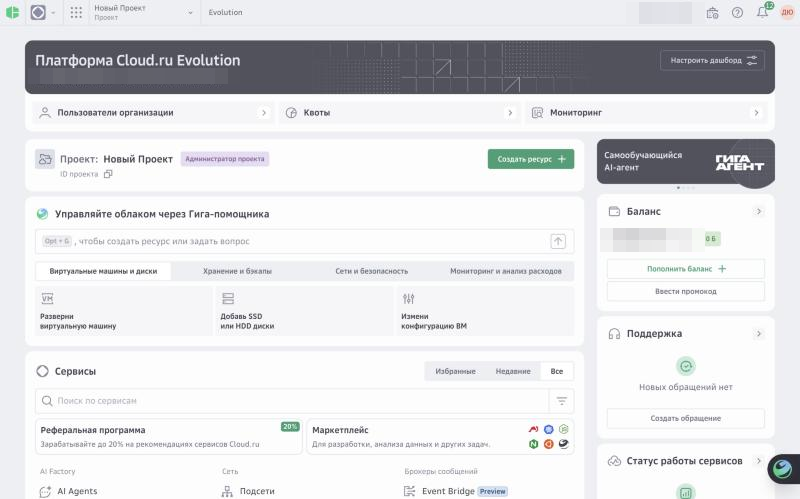
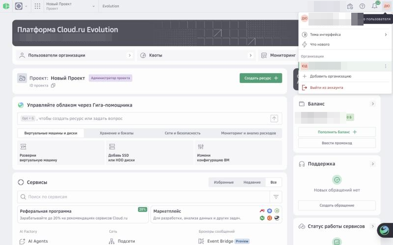
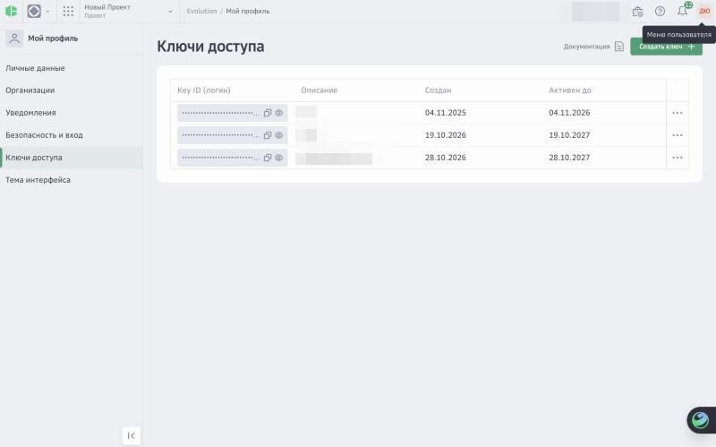
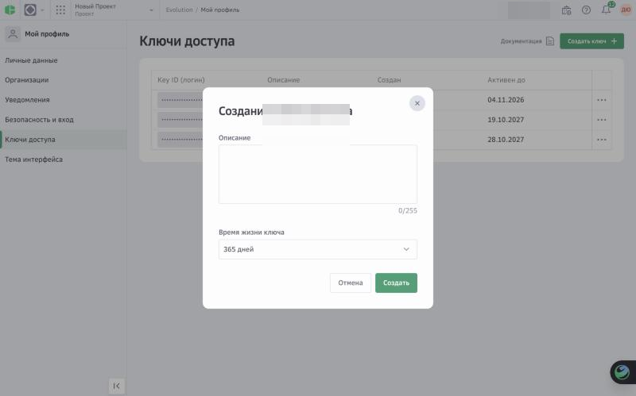
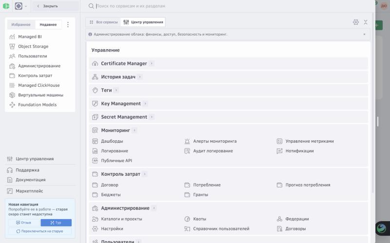
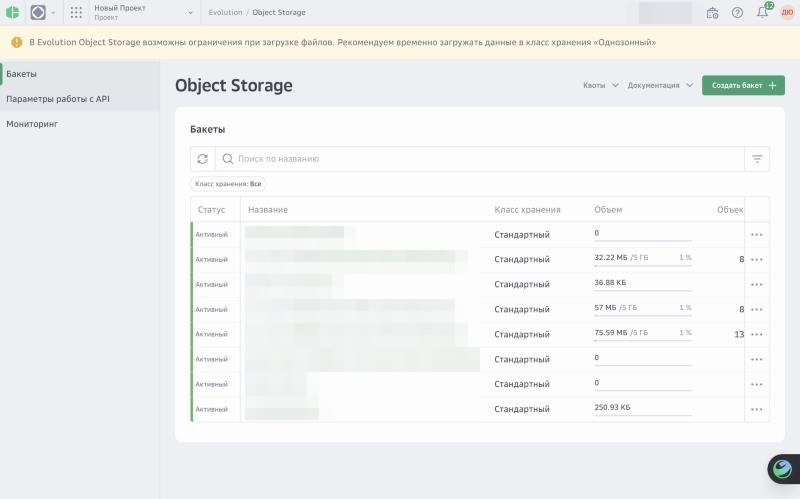
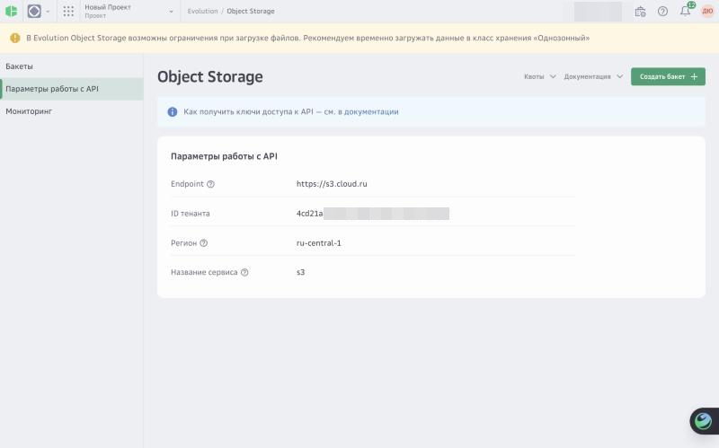
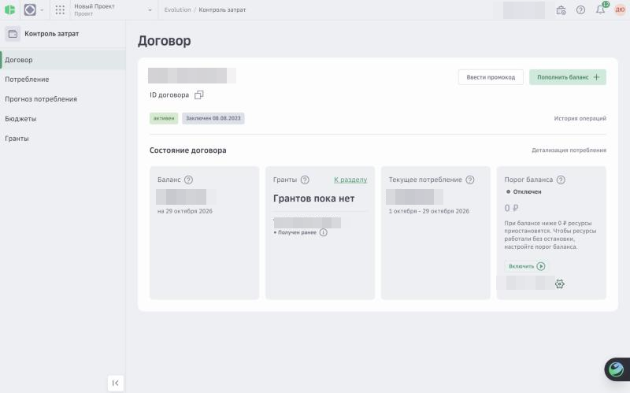
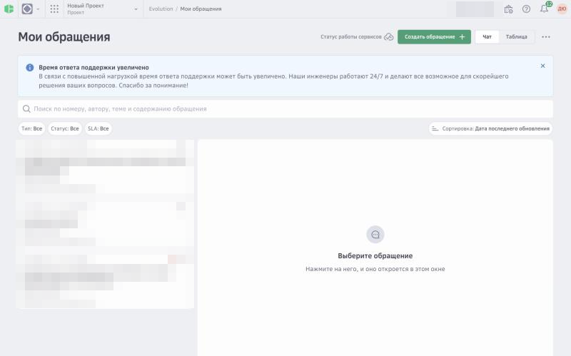
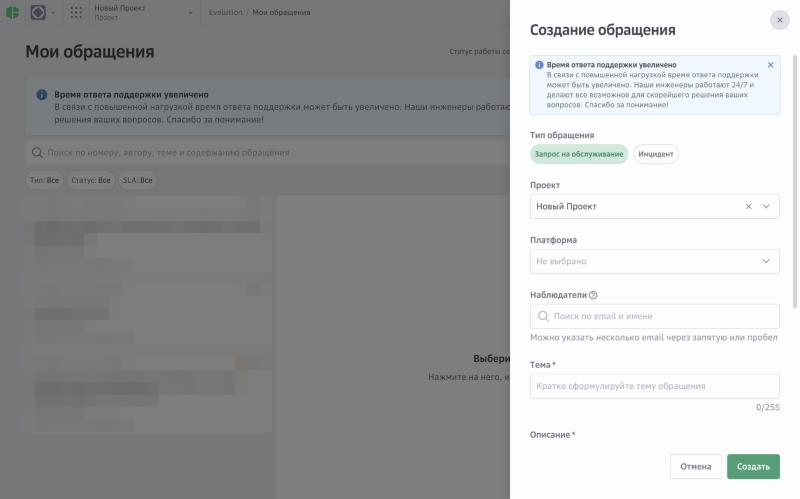

# Шаги пользователя в консоли Cloud.ru

Это единственные действия, которые пользователь выполняет руками. Всё остальное (сервисный аккаунт, роли, сеть, база, BI, сервер MCP) агент создаёт через API. Выдавай шаги по одному, дословно, с указанием «где → что нажать → что скопировать». Названия пунктов и скриншоты проверены 29.10.2026 в реальной консоли (новая навигация Evolution); если экран выглядит иначе, попроси пользователя описать, что он видит, и сверься с документацией Cloud.ru. Не управляй браузером пользователя.

Скриншоты лежат в `images/` рядом с этим файлом (800×499, личные данные и суммы замазаны). Показывай картинку вместе с текстом шага, если клиент умеет отображать файлы; иначе опиши словами то, что на ней. Как обновлять картинки — в конце файла.

## Шаг A. Вход в консоль

Где: https://console.cloud.ru. Вход по телефону/email или Сбер ID. Коды подтверждения агенту не нужны.

Что сказать: «Откройте console.cloud.ru и войдите. Когда увидите главную страницу с плитками сервисов, напишите „вошёл“».

Скриншот:  — главная страница: слева вверху кнопка с девятью точками (меню сервисов), в центре блок «Проект», справа баланс и блок «Поддержка», справа вверху кружок с инициалами.

## Шаг B. Личный ключ доступа (Key ID + Key Secret)

Зачем: это единственный ключ, который нужен агенту. Им агент создаёт сервисный аккаунт для сервера, выдаёт ему роли и разворачивает всё остальное. Ключ сервисного аккаунта для API Data Platform/Managed BI не подходит (отвечает 500/403, проверено 28.10.2026), поэтому нужен именно личный.

Где: правый верхний угол консоли → кружок с инициалами → в открывшемся меню нажать на **своё имя** (первая строка, под ней email) → откроется «Мой профиль» → в левом списке пункт **Ключи доступа** → зелёная кнопка **Создать ключ** справа вверху.

Что заполнить в окне «Создание ключа доступа»: поле **Описание** — «Отчёт по продажам (агент)»; поле **Время жизни ключа** — по умолчанию 365 дней, можно оставить или выбрать меньше (не меньше срока пилота). Затем **Создать**. Ключ можно отозвать в том же списке через меню «⋯» в любой момент.

Что скопировать: **Key ID** и **Key Secret**. Секрет показывается один раз: окно не закрывать, пока агент не откроет защищённый терминал.

Что сказать: «Нажмите на свои инициалы справа вверху, затем на своё имя в меню. Слева выберите „Ключи доступа“ и нажмите „Создать ключ“. Описание любое, срок можно оставить 365 дней. Окно с ключом не закрывайте: сейчас открою вкладку терминала, куда вы вставите Key ID и Key Secret. В чат их не присылайте».

Скриншоты:   . Окно с готовым Key ID / Key Secret не снято намеренно: оно показывается один раз и содержит секрет.

Куда вводить: агент запускает `scripts/connect_cloud.py` во вкладке терминала приложения. Символы при вставке не отображаются: вставить Key ID → Enter → Key Secret → Enter. Скрипт только проверяет ключ в IAM и сохраняет его в файл с правами 0600; ресурсы не создаёт.

## Шаг C. Tenant ID хранилища Object Storage

Зачем: ключ доступа к Object Storage по протоколу S3 имеет вид `tenant_id:key_id`; Tenant ID нельзя получить через IAM API, он виден только в консоли.

Где: кнопка с девятью точками слева вверху → в открывшемся меню найти **Object Storage** (строка поиска сверху, список «Недавнее» слева или вкладка «Все сервисы» → раздел «Хранение данных») → на странице Object Storage в левом списке пункт **Параметры работы с API**.

Что скопировать: строку **ID тенанта** (UUID из пяти групп через дефис). Рядом видны Endpoint `https://s3.cloud.ru` и регион `ru-central-1`. Это идентификатор, не секрет, его можно прислать в чат.

Что сказать: «Нажмите на девять точек слева вверху, найдите „Object Storage“. Слева выберите „Параметры работы с API“ и пришлите мне строку „ID тенанта“. Это идентификатор, не секрет».

Скриншоты:   .

## Шаг D. Подтверждения и оплата

Пользователь сам следит за балансом. Перед созданием ресурсов агент показывает полную смету и получает одно согласие на всё сразу (см. SKILL.md, «Одно согласие»). Если баланс ниже нуля, Cloud.ru приостанавливает ресурсы; пополнение — кнопка **Пополнить баланс** на главной странице или в разделе **Контроль затрат → Договор** (меню сервисов → «Центр управления»). Там же «Порог баланса» и «Прогноз потребления». Сумму агент не навязывает: называет минимальные расходы на согласованный срок.

Скриншот: .

## Шаг E. Открыть дашборд

Где: ссылка `https://<host>/report/`, которую присылает агент (возвращается инструментом `sales_publish_dashboard`). Браузер спросит логин и пароль: логин `sales`, пароль агент кладёт в буфер обмена командой, которую пользователь запускает сам (пароль не появляется ни в чате, ни на экране). Сертификат публичный (Let's Encrypt), устанавливать ничего не нужно. Открывается только с IP, разрешённого в группе безопасности.

Что сказать: «Запустите команду ниже — она скопирует пароль. Откройте ссылку, логин sales, пароль вставьте через Cmd+V. Напишите, видите ли выручку и маржу».

## Шаг E1 (необязательно). Managed BI

Подготовка (один раз на каждом устройстве): внешний адрес Managed BI защищён сертификатом частного центра Cloud.ru, поэтому сначала нужно установить корневой сертификат Cloud.ru по официальной инструкции [«Добавить root-сертификат»](https://cloud.ru/docs/managed-bi/ug/topics/guides__root-certificate) (Windows: скачать файл → открыть → «Установить сертификат» → «Готово»). Без этого браузер покажет ошибку «сертификат не является доверенным».

macOS, проверено 29.10.2026:
1. Дважды щёлкнуть файл сертификата; если спросят связку — выбрать «Вход» (login).
2. В «Связке ключей» найти «Cloud.ru External Root CA», открыть двойным щелчком.
3. Раздел «Доверие» → «При использовании этого сертификата» → «Всегда доверять»; закрыть окно и подтвердить паролем.
4. **Полностью перезапустить Chrome через Cmd+Q** (закрытие окна не помогает: Chrome остаётся в фоне и не видит новый сертификат). Safari подхватывает сертификат сразу.

Альтернатива одной командой (пользователь запускает сам, macOS спросит пароль): `security add-trusted-cert -r trustRoot -k ~/Library/Keychains/login.keychain-db <файл.crt>`. Агент сам сертификат в систему не устанавливает: это изменение настроек безопасности пользователя. Проверить, что сертификат появился и доверен, агент может командами `security find-certificate -c "Cloud.ru External Root CA"` и `security dump-trust-settings`. Firefox использует собственное хранилище — там сертификат импортируется в настройках браузера. Проверенный отпечаток SHA-256 корневого сертификата «Cloud.ru External Root CA»: 10:7E:48:3A:2F:52:E4:CF:01:D9:C2:9A:68:B4:61:E6:96:95:AD:5D:4E:AE:8A:69:BD:DA:BF:E8:1E:75:DB:11 (действует до 2035 года).

Где: ссылка Managed BI, которую пришлёт агент (внешний адрес инстанса, домен `…dataplatform.cloud.ru`). На странице входа единственный способ — кнопка входа через **Cloud.ru** (вход тем же аккаунтом, что и в консоль). Логин/пароль Superset пользователю не нужны и не выдаются.

Что сказать: «Сначала установите корневой сертификат Cloud.ru по инструкции из документации (ссылка), иначе браузер не откроет отчёт. Затем откройте ссылку и нажмите кнопку входа через Cloud.ru, войдите своим аккаунтом. Дашборд „Отчёт по продажам“ находится в разделе Dashboards. Напишите, открылся ли он».

Скриншоты: пока нет (встроенный браузер агента не доверяет частному сертификату, снимок делает пользователь).

### Шаг E2 (необязательно). Подключить базу и собрать дашборд в Managed BI вручную

Почему руками: вход в Managed BI только через Cloud.ru (OAuth), у Superset нет логина для API, поэтому `sales_bi_connect`/`sales_bi_publish` не работают без браузера. Агент даёт параметры, пользователь вводит их в форме. Пароль читателя агент в чат не пишет: он копирует его в буфер обмена скриптом, который пользователь запускает сам.

1. **Settings** (справа вверху) → **Database Connections** → **+ Database** → **ClickHouse Connect**.
2. Поля: Host — IP из `clickhouse_hosts` (без порта), Port — `8123`, Database name — `sales_report`, Username — `sales_reader`, Password — вставить из буфера (Cmd+V), Display name — «Отчёт по продажам», SSL — выключен (кластер внутри VPC отдаёт только HTTP). **Connect** → **Finish**. Если в списке нет ClickHouse Connect, выбрать «Other» и SQLAlchemy URI `clickhousedb://sales_reader:<пароль>@<ip>:8123/sales_report`; пароль тоже вставляется из буфера.
3. **Datasets** → **+ Dataset**: база «Отчёт по продажам», схема `sales_report`, таблица `mcp_sales_current_v1` → **Create dataset and create chart**.
4. Графики: «Таблица» (Table) с группировкой по `channel` и метриками `SUM(net_revenue)`, `SUM(contribution)`, `SUM(contribution)/SUM(net_revenue)*100`; при желании столбчатая диаграмма по `category`. **Save** → добавить в новый дашборд «Отчёт по продажам».
5. Проверка: итог по выручке и вкладу совпадает с `sales_report` (агент называет ожидаемые суммы).

## Шаг F (только при проблемах). Обращение в поддержку

Когда нужен: кластер ClickHouse более 45 минут в статусе «Создается» без хостов или Managed BI не создаётся на бесплатном тарифе. Агент готовит текст обращения со всеми идентификаторами (шаблон в `troubleshooting.md`); пользователь отправляет его.

Где: на главной странице блок **Поддержка** → **Создать обращение** (или меню сервисов → «Поддержка»). В форме: **Тип обращения** — «Инцидент», **Проект** — проект отчёта, **Платформа** — Evolution, **Тема** и **Описание** — из текста агента, затем **Создать**.

Скриншоты:  .

## Как обновлять скриншоты

0. Текущие снимки сделаны 29.10.2026 во встроенном браузере приложения после самостоятельного входа пользователя; имена, суммы, номера договора/карты и названия чужих ресурсов замазаны.
1. Агент никогда не делает скриншоты консоли сам через браузер пользователя. Допустимо: пользователь открывает консоль во встроенном браузере приложения и сам проходит экран, агент сохраняет снимок экрана в `images/` (без секретов: Key Secret, пароли, номера карт должны быть замазаны или не попадать в кадр).
2. Либо пользователь присылает скриншот файлом; агент кладёт его под именем из списка выше и обрезает лишнее.
3. В тексте шага ссылка на картинку даётся только если файл существует. Проверяй `ls references/images` перед выдачей инструкции.
4. При расхождении картинки и текущего интерфейса обновляй и текст, и файл, указывая дату проверки.
